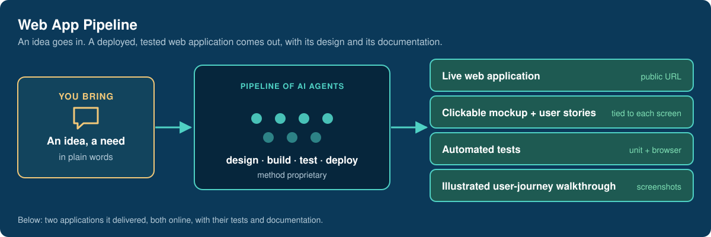
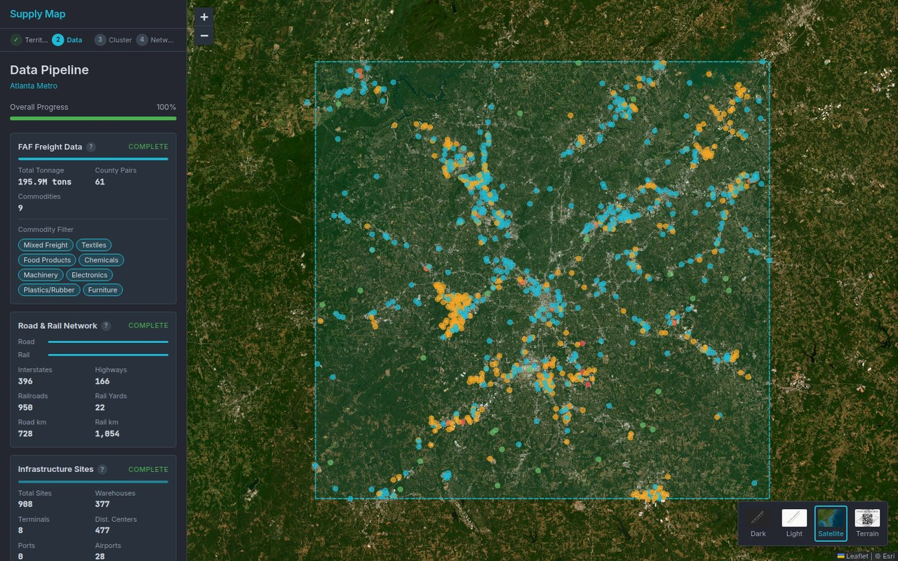
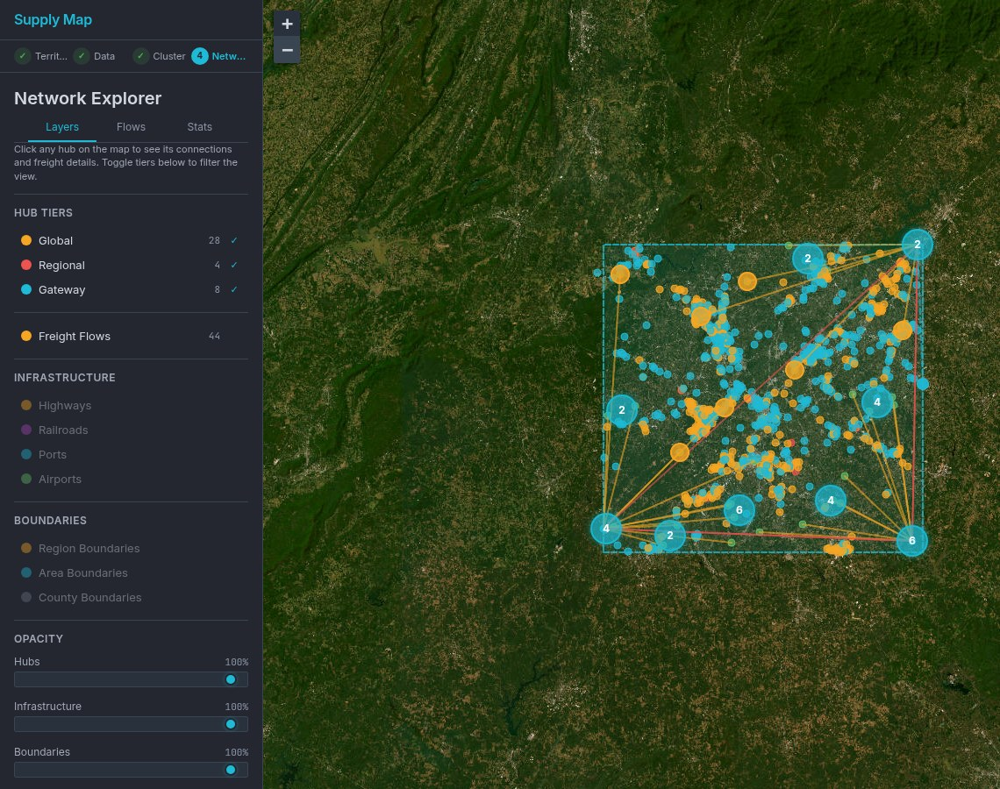
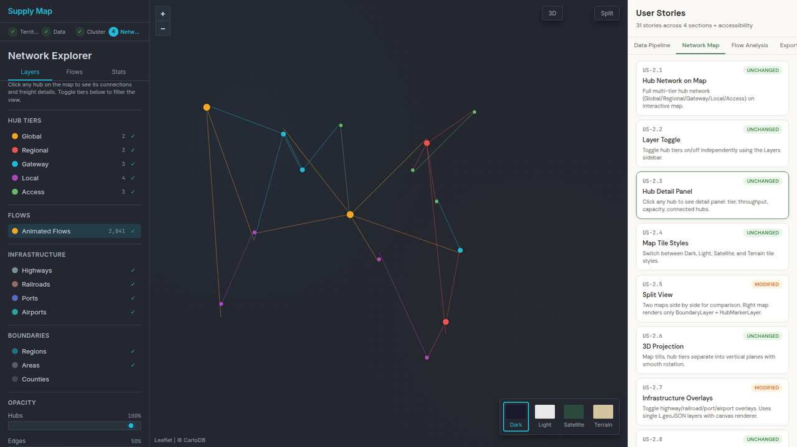
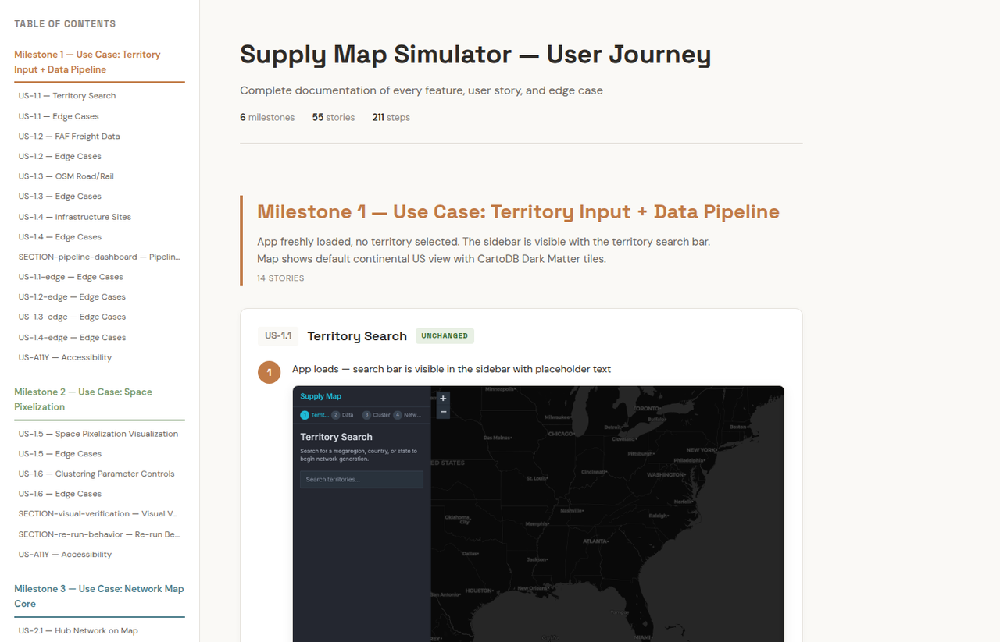
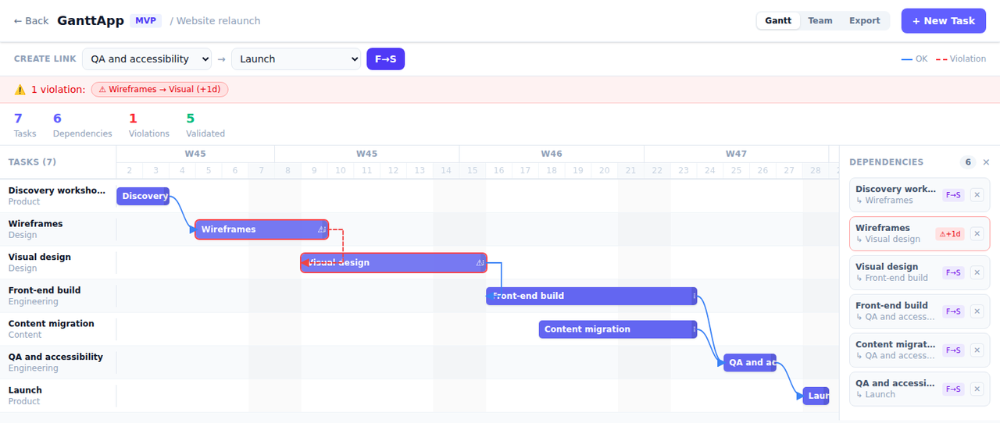

# Web App Pipeline

**A pipeline of AI agents that designs, builds, tests and deploys web applications: an idea goes in, a live application comes out with its clickable mockup, its user stories, its automated tests and an illustrated walkthrough.**

## Why

Getting a working prototype out of an AI coding assistant is easy. Getting an application that is specified, tested, deployed and documented well enough for someone else to take over is not. The pipeline is built for the second outcome: every delivery comes with the evidence that it does what was asked.

## Delivered: Supply Map Simulator

**[Open the live app](https://supply-map-simulator.vercel.app)**: in the browser, nothing to install.

A freight-network designer for the Physical Internet, following the methodology of Garbers, Muthukrishnan & Montreuil (IPIC 2025). Pick a US territory; the app loads real freight flows and real road, rail and logistics sites, groups counties into demand regions, then places a multi-tier hub network.

**1. Real data, loaded live.** County-to-county tonnage by commodity (FAF5), interstates, railroads and logistics sites from OpenStreetMap. Here, the Atlanta metro area.

**2. The network.** Hubs by tier and freight flows on the map, with corridor analysis, statistics, 3D and split views, and export to PNG, GeoJSON, JSON and CSV.

### What came with it

**A clickable mockup with its user stories.** Each story is tied to the screen it describes; selecting one opens that screen.

**An illustrated walkthrough** of every story, step by step, built from screenshots of the running app: [open it](https://supply-map-simulator.vercel.app/walkthrough.html) (large page, about 60 MB).

The walkthrough lists edge cases and accessibility checks as entries of their own, hence 55 entries for 31 user stories.

## Delivered: GanttApp

**[Open the live app](https://rtyui-alpha.vercel.app)**: a lightweight Gantt planner. Projects, tasks, finish-to-start dependencies with conflict detection, team view, PNG export and read-only share links.

Demonstration project typed in for the screenshot. The app keeps its data in the visitor's browser.

## The numbers

| | Supply Map Simulator | GanttApp |
|---|---|---|
| **First commit → in production** | 4 days (7–10 April 2026) | about 4 hours (16 March 2026) |
| **User stories** | 31, plus 65 edge cases | 52 |
| **Unit tests**, re-run on 14 October 2026 | 111, all passing | 122, all passing |
| **Browser test scenarios** (Playwright) | 119 | — |

Counted from each application's commit history, specification, test files and deployment history. The durations do not include the design work done before the first commit.

## Status

Both applications are online. Others built with the pipeline belong to clients or to an employer and are not shown here.

Stack of the apps shown: React + TypeScript (Vite) · Zustand · Vercel · Vitest; Supply Map adds Leaflet and Playwright.

## Why the pipeline itself is not here

The method is proprietary and is not published. This page shows only what the pipeline is given and what it delivers. Happy to demonstrate it live with anyone evaluating a collaboration.

---

**Anthony Hunt** — applied agentic AI: evaluating, training and deploying specialised agents.
[GitHub profile](https://github.com/anthohunt) · [anthony.hunt@yahoo.fr](mailto:anthony.hunt@yahoo.fr)

Map imagery in the screenshots: Esri World Imagery. Data: © OpenStreetMap contributors; Freight Analysis Framework (FAF5), U.S. Bureau of Transportation Statistics. © 2026 Anthony Hunt.
